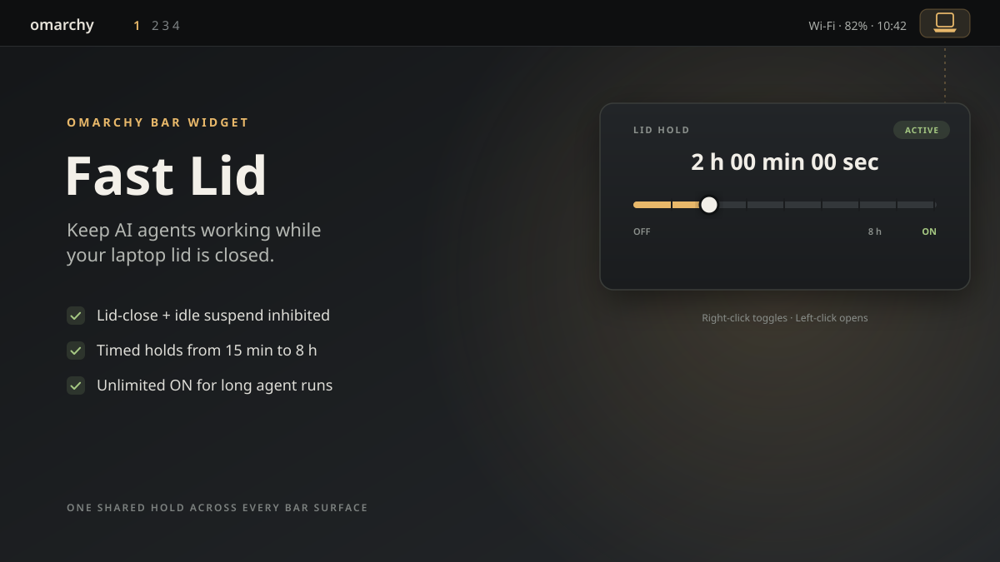

<h1 align="center">Fast Lid</h1>
<p align="center">Let AI agents keep working while your laptop lid is closed. An unofficial <a href="https://omarchy.org">Omarchy</a> bar widget.</p>

<p align="center"></p>

## Install

```sh
omarchy plugin add https://github.com/CloudDown/fast-lid.git --enable
```

Remove: `omarchy plugin remove clouddown.fast-lid`.

## Usage

Right-click the laptop icon to toggle Fast Lid and show the duration slider;
left-click it to open the slider without toggling. The left end turns Fast Lid
off; the other positions select 15 minutes to 8 hours in 15-minute increments,
and the far right shows ON and keeps it on indefinitely. The hold ends when the chosen time
expires or the plugin service stops. A solid laptop means the hold is on; a
slashed laptop means it is off. The hold is shared across bar surfaces. Only
failures send a desktop notification.

Fast Lid inhibits lid-close and idle suspend only. Explicit suspend, shutdown,
and critical-battery actions are not blocked. A closed laptop can get hot and
drain its battery: keep vents clear and never leave it running closed in a bag.

<p align="center"><a href="docs/GUIDE.md">Guide</a> · MIT · No network access or external account required.</p>
