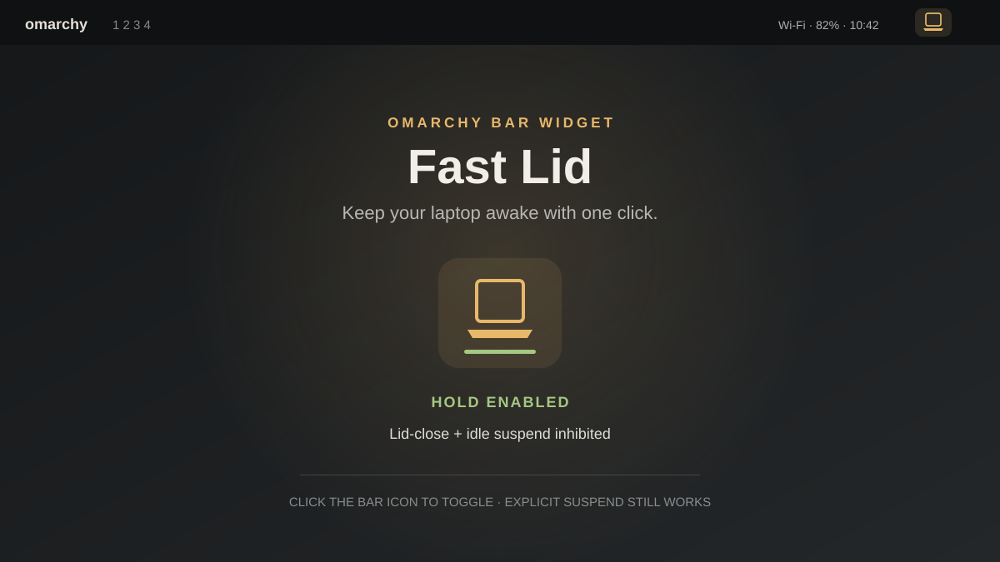

<h1 align="center">Fast Lid</h1>
<p align="center">Keep your laptop awake with one click. An unofficial <a href="https://omarchy.org">Omarchy</a> bar widget.</p>

<p align="center"></p>

## Install

```sh
omarchy plugin add https://github.com/CloudDown/fast-lid.git --enable
```

Remove: `omarchy plugin remove clouddown.fast-lid`.

## Usage

Click the laptop icon in the bar to toggle Fast Lid. A solid laptop means the
hold is on; a slashed laptop means it is off. The hold is shared across bar
surfaces and ends when the plugin service stops.

Fast Lid inhibits lid-close and idle suspend only. Explicit suspend, shutdown,
and critical-battery actions are not blocked. A closed laptop can get hot and
drain its battery: keep vents clear and never leave it running closed in a bag.

<p align="center"><a href="docs/GUIDE.md">Guide</a> · MIT · No network access or external account required.</p>
