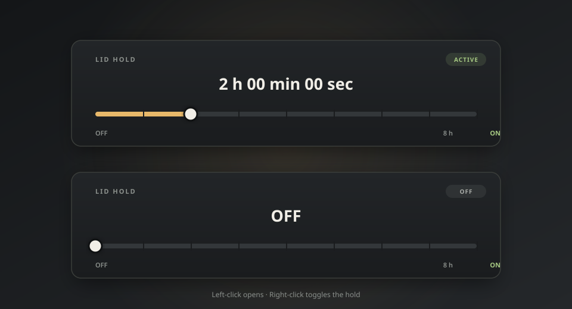

# Fast Lid guide

Fast Lid is an Omarchy bar toggle for keeping a laptop awake while its lid is
closed or it is otherwise idle. It is especially useful for leaving long-running
AI coding agents and terminal sessions working unattended.

## How it works

When enabled, the shared plugin service runs `systemd-inhibit` with a block lock
for `handle-lid-switch:idle`. Disabling the toggle releases the lock. The
service owns the process, so a shell restart, plugin disable, or removal ends
the hold and restores normal logind behavior.

The inhibit does not cover explicit sleep or shutdown. It does not prevent a
critical-battery action. It does not change logind, Hyprland, or other user
configuration.

## Bar control

- Solid laptop icon: hold enabled.
- Slashed laptop icon: hold disabled.
- Right-click either icon on any bar surface to toggle the hold and show the
  duration slider. Left-click opens the slider without toggling the hold.
- The left end turns the hold off; choose 15 minutes to 8 hours in 15-minute
  steps, or the far right (ON) for an unlimited hold. Selecting a duration starts a
  fresh timer, and the hold stops when that timer expires. The panel displays
  the remaining time in hours, minutes, and seconds.
- Move the pointer away from the icon and panel, or click outside, to close it.
  Only failures send an Omarchy notification.
- The `clouddown.fast-lid` shell toggle can also be used from Omarchy's shell
  interface.



## Safety

A laptop running closed can overheat and consume battery quickly. Keep vents
unobstructed, do not place a running laptop in a bag, and monitor its battery
and temperature.

## Install and remove

```sh
omarchy plugin add https://github.com/CloudDown/fast-lid.git --enable
omarchy plugin remove clouddown.fast-lid
```

Fast Lid uses Omarchy's `omarchy-notification-send` helper for failures and systemd's
`systemd-inhibit`; both are provided by a standard Omarchy installation. It
does not download software, access the network, or write persistent state.
Removing the plugin leaves no process, service, configuration change, or
plugin-owned data behind.

## License

MIT. See [`../LICENSE`](../LICENSE).
